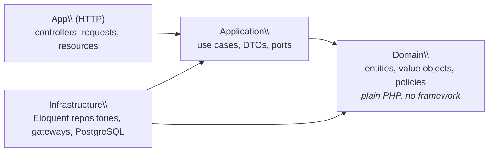
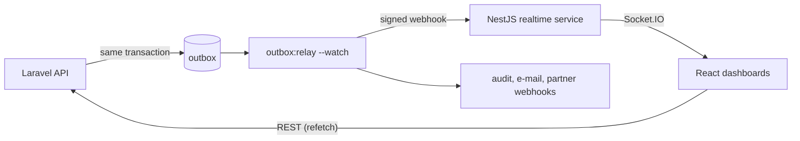

# Bookly

> A space booking platform (meeting rooms, sports courts, event halls) that
> puts a framework-free domain at the centre of a Laravel API. It has real
> business rules, design patterns where they earn their place, tests at every
> layer, and a NestJS service that keeps every open calendar live.


**In numbers:** 9 ADRs · 381 PHP tests (unit, architecture, integration,
concurrency, HTTP) · 100% of mutants killed in the domain and use cases ·
98% line coverage · 44 NestJS tests · 19 React tests · 8 Playwright
end-to-end tests against the real stack, all run by CI on every pull request.

## For reviewers: where to look

| Topic | Where it shows |
|---|---|
| **Object-oriented design** | A rich `Booking` aggregate that guards its own state transitions and records events ([`Booking.php`](src/Domain/Booking/Booking.php)). Value objects instead of primitives: [`Money`](src/Domain/Shared/Money.php) (minor units, never floats), [`TimeSlot`](src/Domain/Shared/TimeSlot.php) (half-open, UTC, DST-safe), typed ids that can't be mixed up |
| **Design patterns** | Strategy, Specification + Composite, Adapter, Repository, Observer, Transactional Outbox, Registry: [the catalogue below](#design-patterns-and-why-each-one-is-here) links each one to its code and the problem it solves |
| **SOLID** | [Concrete examples below](#solid-in-practice), with dependency rules **enforced by tests** ([`LayersTest.php`](tests/Arch/LayersTest.php)) |
| **Test layers** | Unit (no framework), architecture, integration (real PostgreSQL), concurrency (8 processes), HTTP, contract suites shared by fakes and real adapters, mutation testing, React component tests, Playwright E2E ([testing strategy](#testing-strategy)) |
| **Anti-patterns** | A fat controller committed on purpose, then refactored with the same tests passing ([write-up](docs/refactoring/fat-controller.md)). What mutation testing exposed in my own tests ([ADR 0009](docs/adr/0009-mutation-testing.md)) |
| **Node.js** | A NestJS real-time service with ports and adapters, HMAC verification shared with PHP through one test vector, and Socket.IO with per-customer privacy rules ([`realtime/`](realtime), [ADR 0008](docs/adr/0008-realtime-service-fed-by-signed-webhooks.md)) |
| **Written communication** | [9 ADRs](#architecture-decision-records) with context, alternatives and consequences. API problem types, webhook docs, commit messages that explain *why* |

## Try it in 5 minutes

```bash
git clone https://github.com/godinhorafa/bookly.git && cd bookly
docker compose up -d     # API, outbox relay, realtime service, dashboard, PostgreSQL
docker/smoke-test.sh     # optional: waits until everything is up, then books and checks the live push
```

The first start takes a few minutes while the containers install their
dependencies. It creates `.env` and an app key, migrates and seeds the
database. CI runs exactly these commands on every pull request.

1. Open **http://localhost:5173** and log in as **demo@bookly.test / password**.
2. Pick the *Tennis court* and a weekday slot after 18:00, then book it with
   the coupon `WELCOME10`. The quote is itemised: the base price, a +25%
   peak-hour surcharge and the 10% coupon discount.
3. Pay with *Insufficient funds* (the booking stays on hold, with the reason
   shown), then with *Visa*. Cancel it and check that the refund follows the
   space's policy.
4. Open a **second browser window** on the same day and book from the first
   one. The second calendar updates without a reload: API → outbox → relay →
   signed webhook → NestJS → WebSocket.
5. Try `22:30` for 60 minutes: every broken rule is reported at once.

The API documentation is at **http://localhost:8000/docs/api**.

### A short code tour

1. [`BookingController`](app/Http/Controllers/Api/BookingController.php): thin HTTP adapters. Each action calls one use case and shapes the response.
2. [`BookSpaceHandler`](src/Application/Booking/BookSpaceHandler.php): one use case, talking only to ports.
3. [`Booking`](src/Domain/Booking/Booking.php) and [`Money`](src/Domain/Shared/Money.php): domain code in plain PHP.
4. [`EloquentBookingRepository`](src/Infrastructure/Persistence/Eloquent/EloquentBookingRepository.php) and [the bookings migration](database/migrations/2026_10_18_000002_create_bookings_table.php): overbooking is impossible at the database level.
5. [`ConcurrentBookingTest`](tests/Concurrency/ConcurrentBookingTest.php): 8 processes race for one slot, and exactly one wins.
6. [`OutboxRelay`](src/Application/Event/OutboxRelay.php) and [`fan-out.ts`](realtime/src/events/fan-out.ts): how a booking reaches other people's screens.

## The domain

Booking is a small domain with non-trivial rules:

- **No overbooking**, even under concurrent requests
- **Dynamic pricing**: peak hours in the space's local time, long-booking discounts, coupons
- **Cancellation policies per space**: for example, 100% refund up to 48h before and 50% up to 24h
- **Booking rules**: minimum notice, horizon, duration, a 15-minute grid, opening hours and a per-customer cap
- **Payments** through Stripe or a fake gateway, with safe retries
- **Notifications**: audit trail, e-mail, signed webhooks, and live calendars

## Architecture



Around the API, booking events flow out through the outbox to a separate
real-time service:



Dependencies point inwards only. This is **enforced by architecture tests**
(`tests/Arch/LayersTest.php`): the build fails if the domain imports Laravel,
Carbon or an outer layer. See [ADR 0001](docs/adr/0001-layered-architecture-with-framework-free-domain.md).

### Highlights

| Concern | Approach |
|---|---|
| Repositories | Domain-owned ports, Eloquent adapters, `23P01` translated to `SlotUnavailable` ([ADR 0003](docs/adr/0003-repositories-with-contract-tests.md)) |
| Overbooking | PostgreSQL `EXCLUDE USING gist` on a half-open `tstzrange`, partial on `status <> 'cancelled'` ([ADR 0002](docs/adr/0002-exclusion-constraint-for-overbooking.md)) |
| Pricing | `PricingRule` strategies (peak hours in the space's local time, long-booking discount, coupons) composed by an ordered `PricingPipeline` that returns an itemised `Quote` ([ADR 0004](docs/adr/0004-pricing-and-cancellation-as-strategies.md)) |
| Cancellation | `CancellationPolicy` strategies chosen per space (flexible / moderate / strict / non-refundable), tiered refunds, time injected through a `Clock` port |
| Booking rules | Composable **Specifications** (`and` / `or` / `not`): notice, horizon, duration, 15-min grid and opening hours in the space's local time, per-customer cap. Every violation is reported at once ([ADR 0005](docs/adr/0005-booking-rules-as-specifications.md)) |
| Payments | `PaymentGateway` port with **Stripe** (REST, no SDK) and **Fake** adapters behind one contract suite that also runs against real Stripe test mode. Deterministic idempotency keys make retries safe ([ADR 0006](docs/adr/0006-payment-gateway-port-and-adapters.md)) |
| Domain events | Aggregates record events; a **transactional outbox** stores them with the change, and a relay delivers them (**Observer**) to audit, e-mail and HMAC-signed webhooks: at least once, tracked per subscriber, ordered per booking, safe with concurrent relays (`SKIP LOCKED`) ([ADR 0007](docs/adr/0007-domain-events-and-transactional-outbox.md)) |
| Real time | A **NestJS** service receives the same signed webhooks as any partner, dedupes redeliveries, and pushes over Socket.IO: *slot taken/freed* to everyone (no personal data), *your booking changed* to its owner. Dashboards refetch on these hints ([ADR 0008](docs/adr/0008-realtime-service-fed-by-signed-webhooks.md)) |
| Money | `Money` value object in minor units with a `Currency` enum, so no floats |
| Time | `TimeSlot` value object, half-open `[start, end)`, normalised to UTC, DST-safe durations |
| Code style & safety | `declare(strict_types=1)` everywhere, `readonly` value objects, PHPStan **level max**, Pint, Rector |

## Design patterns, and why each one is here

| Pattern | Where | The problem it solves |
|---|---|---|
| **Strategy** | [`PricingRule`](src/Domain/Pricing/PricingRule.php) ([peak hours](src/Domain/Pricing/Rule/PeakHourSurcharge.php), [long booking](src/Domain/Pricing/Rule/LongBookingDiscount.php), [coupon](src/Domain/Pricing/Rule/CouponDiscount.php)), [`CancellationPolicy`](src/Domain/Cancellation/CancellationPolicy.php) | Prices and refunds vary by rule and by space. A new rule is a new class, not another `if` |
| **Pipeline** | [`PricingPipeline`](src/Domain/Pricing/PricingPipeline.php) | Rules apply in an explicit order (surcharges before discounts), and each one adds a line to the quote |
| **Specification + Composite** | [`Specification/`](src/Domain/Booking/Specification) (`and`, `or`, `not`) | Booking rules combine freely, and the customer sees *every* violation at once |
| **Repository** | [`BookingRepository`](src/Domain/Booking/BookingRepository.php) and its Eloquent and in-memory implementations | The domain doesn't know about Eloquent. Unit tests run without a database |
| **Adapter (ports and adapters)** | [`PaymentGateway`](src/Domain/Payment/PaymentGateway.php) → [Stripe](src/Infrastructure/Payment/StripePaymentGateway.php) / [Fake](src/Infrastructure/Payment/FakePaymentGateway.php); `Clock`, `Transaction`, and `IdentityProvider` in NestJS | Swap providers without touching use cases; make time and transactions testable |
| **Registry** | [`PaymentGateways`](src/Domain/Payment/PaymentGateways.php) | A refund goes back to the gateway that took the charge, even after the default changes |
| **Observer** | [`OutboxRelay`](src/Application/Event/OutboxRelay.php) and [`EventSubscriber`](src/Application/Event/EventSubscriber.php) | Adding a reaction to an event (e-mail, webhook, audit) never touches booking code |
| **Transactional Outbox** | [`PostgresOutbox`](src/Infrastructure/Event/PostgresOutbox.php) | An event exists if, and only if, its change was committed. No lost or phantom notifications |
| **Value Object** | [`Money`](src/Domain/Shared/Money.php), [`TimeSlot`](src/Domain/Shared/TimeSlot.php), [`WeeklyWindow`](src/Domain/Shared/WeeklyWindow.php) | Rules about money and time live in one place instead of in every caller |
| **Named constructors** | `Booking::request`, `Coupon::percentage`, `ChargeResult::declined` | Valid objects only, with intent in the name |

Not every pattern is used everywhere. For example, there are no
interfaces for value objects and no repository for read-only lookups that one
query handles.

## SOLID in practice

- **Single responsibility:** a controller translates HTTP
  ([`BookingController`](app/Http/Controllers/Api/BookingController.php)), a
  handler runs a use case ([`BookSpaceHandler`](src/Application/Booking/BookSpaceHandler.php)),
  and one class maps domain errors to HTTP problems
  ([`DomainProblems`](app/Http/Problem/DomainProblems.php)). Idempotency is
  middleware, not controller code ([`Idempotency`](app/Http/Middleware/Idempotency.php)).
- **Open/closed:** a new pricing rule, cancellation policy, booking rule or
  event subscriber is a new class plus one line in
  [`InfrastructureServiceProvider`](src/Infrastructure/Laravel/InfrastructureServiceProvider.php).
  Existing code doesn't change.
- **Liskov substitution:** the fakes are proven substitutable. One
  [contract suite](tests/Contracts) runs against the in-memory and PostgreSQL
  repositories, the in-memory and PostgreSQL outboxes, and the fake and Stripe
  gateways.
- **Interface segregation:** small ports. `Clock` and `Transaction` have one
  method each, and `PaymentGateway` has three.
- **Dependency inversion:** the domain and use cases depend on interfaces they
  own, and the infrastructure implements them. The build fails if `src/Domain`
  imports Laravel, Carbon or an outer layer
  ([`LayersTest`](tests/Arch/LayersTest.php)).

## Testing strategy

| Suite | What it covers | Boots Laravel? | Database |
|---|---|---|---|
| `Unit` | Domain rules, value objects and use cases (with in-memory repositories) | No | None |
| `Arch` | Layer dependency rules, immutability, strict types | No | None |
| `Integration` | Repositories and DB constraints | Yes | **Real PostgreSQL** (not SQLite) |
| `Concurrency` | 8 parallel processes racing for one slot: exactly one wins | Yes | Real PostgreSQL |
| `Feature` | HTTP contract of every endpoint, including problem responses and idempotency | Yes | Real PostgreSQL |

The same **contract suite** (`tests/Contracts`) runs against the in-memory and
the PostgreSQL repositories, so the fakes used in unit tests can't drift from
production behaviour ([ADR 0003](docs/adr/0003-repositories-with-contract-tests.md)).

**Mutation testing** checks that the tests would actually catch a bug. Pest
changes the domain and use-case code one small way at a time (`>` into `>=`,
`+ 1` into `+ 2`, a dropped call) and every change must make a unit test fail.
CI requires **100% of mutants killed**, plus **95% line coverage** overall. The
first run scored 82%, and the survivors were real gaps: untested event
payloads, boundaries and a coupon expiry check
([ADR 0009](docs/adr/0009-mutation-testing.md)).

The realtime service has its own suite (Vitest, `realtime/`): unit tests for
the signature, parsing and fan-out rules, and end-to-end tests that drive the
real Nest app over HTTP and Socket.IO. The webhook signature is checked by
**both** languages against one shared example
([`docs/api/webhook-signature.example.json`](docs/api/webhook-signature.example.json)).

```bash
composer test:unit         # fast feedback, no framework
composer test:integration  # against PostgreSQL, including the concurrency test
composer ci                # pint + rector + phpstan + all tests
composer test:mutate       # mutation testing of src/Domain and src/Application (needs PCOV or Xdebug)
composer test:coverage     # coverage report, fails under 95%
```

## Running locally

See [Try it in 5 minutes](#try-it-in-5-minutes) for Docker. The services run on
these ports: API :8000, dashboard :5173, realtime :3000, PostgreSQL :5432. Run
the PHP suite with `docker compose exec app composer test`.

Without Docker, you need PHP 8.3 with `pdo_pgsql` and PostgreSQL 16 with the `btree_gist` extension available.

## HTTP API

Bearer-token API (Laravel Sanctum). The OpenAPI document is generated from the
code by [Scramble](https://scramble.dedoc.co) and committed as
[`docs/api/openapi.json`](docs/api/openapi.json) (CI fails if it is stale).
With the app running locally it is browsable at `/docs/api`.

| Method | Path | |
|---|---|---|
| `POST` | `/api/tokens` | Exchange credentials for a token |
| `GET` | `/api/spaces` | Spaces with rate, cancellation policy and opening hours |
| `GET` | `/api/spaces/{id}/availability?from=&to=` | Busy slots (no customer data) |
| `GET` | `/api/bookings` | My bookings |
| `POST` | `/api/bookings` | Book a space: itemised quote in the response |
| `GET` | `/api/bookings/{id}` | One of my bookings |
| `POST` | `/api/bookings/{id}/payment` | Pay and confirm (`402` with the reason if declined) |
| `POST` | `/api/bookings/{id}/cancellation` | Cancel; the refund follows the space's policy |

- **Errors** are RFC 9457 `application/problem+json`, mapped from domain
  exceptions in one place ([problem types](docs/api/problems.md)). Rule
  violations list *every* broken rule.
- **`Idempotency-Key`** on every `POST`: a retry returns the original response
  instead of booking or charging twice (`Idempotent-Replayed: true`).

```bash
curl -X POST localhost:8000/api/bookings \
  -H "Authorization: Bearer $TOKEN" -H "Idempotency-Key: $(uuidgen)" \
  -H "Content-Type: application/json" \
  -d '{"space_id":"…","start":"2026-11-03T18:00:00-03:00","end":"2026-11-03T20:00:00-03:00","coupon":"WELCOME10"}'
```

## Dashboard (React + TypeScript)

A small dashboard in [`frontend/`](frontend): pick a space, see the day in the
**space's own time zone** (free, busy, closed), book, read the itemised quote,
pay with a test card and cancel. It is kept organised rather than polished:

- **No hand-written API types**: `src/api/schema.d.ts` is generated from
  `docs/api/openapi.json` with `openapi-typescript`, and the typed client
  (`openapi-fetch`) rejects wrong paths, params or bodies at compile time.
  CI fails if the generated types are stale.
- Every failed request becomes a `ProblemError`, so the UI shows *all*
  broken booking rules from the API's problem document.
- Each mutation sends a fresh `Idempotency-Key`.
- **Live updates**: a Socket.IO connection to the realtime service invalidates
  the affected queries, and a *Live activity* card lists recent changes.
  Without the service, the dashboard works as before.
- TanStack Query for server state; time-zone maths in one module (`lib/time.ts`), unit tested across DST changes.

| Layer | Tool | What |
|---|---|---|
| Unit / component | Vitest + Testing Library | Time and money helpers, schedule model, booking form against a mocked API |
| End to end | Playwright | The whole customer journey against the **real** Laravel API and PostgreSQL with seeded data: log in, book, declined card, pay, invalid request, cancel with refund. Then **two browsers**: one books and cancels, and the other's calendar follows without a reload (API → outbox → relay → webhook → NestJS → WebSocket) |

```bash
cd frontend
npm ci
npm run dev        # http://localhost:5173, proxies /api to the Laravel app on :8000
npm test           # unit + component tests
npm run e2e        # starts the API (fresh `bookly_e2e` database), relay and realtime service, then runs Playwright
```

## Realtime service (NestJS)

[`realtime/`](realtime) is a small NestJS 12 app, organised as ports and adapters like the API:

| Piece | Role |
|---|---|
| `WebhooksController` + `BooklySignatureGuard` | `POST /webhooks/bookly`: HMAC over the raw body, 5-minute replay window |
| `parseBookingEvent` | Validates the body; unknown event types are accepted and ignored |
| `BookingEvents` + `RecentEvents` | Dedupes at-least-once redeliveries, then fans out |
| `fanOut` | Pure function: who hears what (the privacy rules live and are tested here) |
| `RealtimeGateway` | Socket.IO; authenticates the handshake through the `IdentityProvider` port (`GET /api/me` on the API) |

```bash
cd realtime
npm ci
npm test           # unit + end-to-end (real HTTP and WebSocket)
WEBHOOK_SECRET=… API_URL=http://127.0.0.1:8000 npm run dev
```

The webhook format and how to verify it are in [docs/api/webhooks.md](docs/api/webhooks.md).

## Anti-patterns: a fat controller, refactored

The booking endpoint was first committed as a deliberate **fat controller**
(validation, rules, pricing and SQL in one 89-line method, with real bugs:
peak hours in UTC, no opening hours, an unhandled race). The next commit turns it into a 6-line
HTTP adapter over the use case, with the **same feature tests passing
unchanged**: compare [the fat version](https://github.com/godinhorafa/bookly/commit/faa34de) with
[the refactor](https://github.com/godinhorafa/bookly/commit/3829681), or read
[docs/refactoring/fat-controller.md](docs/refactoring/fat-controller.md).

## Architecture Decision Records

- [0001: Layered architecture with a framework-free domain](docs/adr/0001-layered-architecture-with-framework-free-domain.md)
- [0002: PostgreSQL exclusion constraint to prevent overbooking](docs/adr/0002-exclusion-constraint-for-overbooking.md)
- [0003: Repositories over direct Eloquent, verified by contract tests](docs/adr/0003-repositories-with-contract-tests.md)
- [0004: Pricing rules and cancellation policies as strategies](docs/adr/0004-pricing-and-cancellation-as-strategies.md)
- [0005: Booking rules as composable specifications](docs/adr/0005-booking-rules-as-specifications.md)
- [0006: Payment gateway as a port with adapters and a shared contract](docs/adr/0006-payment-gateway-port-and-adapters.md)
- [0007: Domain events delivered through a transactional outbox](docs/adr/0007-domain-events-and-transactional-outbox.md)
- [0008: A NestJS real-time service fed by signed webhooks](docs/adr/0008-realtime-service-fed-by-signed-webhooks.md)
- [0009: Mutation testing gates the domain and use cases](docs/adr/0009-mutation-testing.md)

## Roadmap

Done, apart from the two open items, which are next.


- [x] Project foundation: layers, tooling, CI, Docker
- [x] `Money` and `TimeSlot` value objects
- [x] Overbooking prevented by an exclusion constraint, with integration tests
- [x] `Space` and `Booking` aggregates, `BookSpace` use case, repositories with contract tests
- [x] Concurrency test proving one winner under parallel load
- [x] Pricing rules (Strategy) composed into a pricing pipeline, with itemised quotes
- [x] Cancellation policies and refunds
- [ ] Recurring bookings (weekly series) with a recurrence discount
- [x] Booking validation via composable Specifications, opening hours per space
- [x] Payment gateway port with Fake and Stripe adapters, plus contract tests
- [ ] Expire unpaid bookings after a few minutes
- [x] Domain events → e-mail, webhooks, audit (transactional outbox)
- [x] REST API with OpenAPI docs, idempotency keys and feature tests
- [x] A fat controller refactored into a thin adapter, with the same tests
- [x] React + TypeScript dashboard with types generated from OpenAPI, Playwright E2E
- [x] NestJS real-time notification service (WebSocket)
- [x] Mutation testing (Pest) at 100%, coverage gate at 95%
