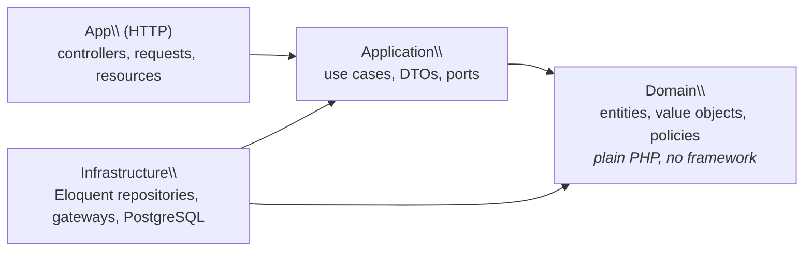

# Bookly

> A space booking API (coworking desks, meeting rooms, sports courts) built to
> show how to design a Laravel application around a framework-free domain: real
> business rules, design patterns where they make sense, and tests at every layer.


## Why this project

Booking is a small domain with non-trivial rules:

- **No overbooking**, even under concurrent requests
- **Dynamic pricing**: peak hours, recurring-booking discounts, coupons
- **Configurable cancellation policies**: 100% refund up to 48h before, 50% up to 24h, and so on
- **Multiple payment gateways** and **notifications** (e-mail, webhooks)

## Architecture



Dependencies point inwards only. This is **enforced by architecture tests**
(`tests/Arch/LayersTest.php`): the build fails if the domain imports Laravel,
Carbon or an outer layer. See [ADR 0001](docs/adr/0001-layered-architecture-with-framework-free-domain.md).

### Highlights

| Concern | Approach |
|---|---|
| Repositories | Domain-owned ports, Eloquent adapters, `23P01` translated to `SlotUnavailable` ([ADR 0003](docs/adr/0003-repositories-with-contract-tests.md)) |
| Overbooking | PostgreSQL `EXCLUDE USING gist` on a half-open `tstzrange`, partial on `status <> 'cancelled'` ([ADR 0002](docs/adr/0002-exclusion-constraint-for-overbooking.md)) |
| Pricing | `PricingRule` strategies (peak hours in the space's local time, long-booking discount, coupons) composed by an ordered `PricingPipeline` that returns an itemised `Quote` ([ADR 0004](docs/adr/0004-pricing-and-cancellation-as-strategies.md)) |
| Cancellation | `CancellationPolicy` strategies chosen per space (flexible / moderate / strict / non-refundable), tiered refunds, time injected through a `Clock` port |
| Booking rules | Composable **Specifications** (`and` / `or` / `not`): notice, horizon, duration, 15-min grid and opening hours in the space's local time, per-customer cap. Every violation is reported at once ([ADR 0005](docs/adr/0005-booking-rules-as-specifications.md)) |
| Payments | `PaymentGateway` port with **Stripe** (REST, no SDK) and **Fake** adapters behind one contract suite that also runs against real Stripe test mode. Deterministic idempotency keys make retries safe ([ADR 0006](docs/adr/0006-payment-gateway-port-and-adapters.md)) |
| Domain events | Aggregates record events; a **transactional outbox** stores them with the change, and a relay delivers them (**Observer**) to audit, e-mail and HMAC-signed webhooks: at least once, tracked per subscriber, ordered per booking, safe with concurrent relays (`SKIP LOCKED`) ([ADR 0007](docs/adr/0007-domain-events-and-transactional-outbox.md)) |
| Money | `Money` value object in minor units with a `Currency` enum, so no floats |
| Time | `TimeSlot` value object, half-open `[start, end)`, normalised to UTC, DST-safe durations |
| Code style & safety | `declare(strict_types=1)` everywhere, `readonly` value objects, PHPStan **level max**, Pint, Rector |

## Testing strategy

| Suite | What it covers | Boots Laravel? | Database |
|---|---|---|---|
| `Unit` | Domain rules, value objects and use cases (with in-memory repositories) | No | None |
| `Arch` | Layer dependency rules, immutability, strict types | No | None |
| `Integration` | Repositories and DB constraints | Yes | **Real PostgreSQL** (not SQLite) |
| `Concurrency` | 8 parallel processes racing for one slot: exactly one wins | Yes | Real PostgreSQL |
| `Feature` | HTTP contract of every endpoint, including problem responses and idempotency | Yes | Real PostgreSQL |

The same **contract suite** (`tests/Contracts`) runs against the in-memory and
the PostgreSQL repositories, so the fakes used in unit tests can't drift from
production behaviour ([ADR 0003](docs/adr/0003-repositories-with-contract-tests.md)).

```bash
composer test:unit         # fast feedback, no framework
composer test:integration  # against PostgreSQL, including the concurrency test
composer ci                # pint + rector + phpstan + all tests
```

## Running locally

```bash
cp .env.example .env
docker compose up -d       # app on http://localhost:8000, PostgreSQL on :5432
docker compose exec app php artisan key:generate
docker compose exec app composer test
```

Without Docker, you need PHP 8.3 with `pdo_pgsql` and PostgreSQL 16 with the `btree_gist` extension available.

## HTTP API

Bearer-token API (Laravel Sanctum). The OpenAPI document is generated from the
code by [Scramble](https://scramble.dedoc.co) and committed as
[`docs/api/openapi.json`](docs/api/openapi.json) (CI fails if it is stale).
With the app running locally it is browsable at `/docs/api`.

| Method | Path | |
|---|---|---|
| `POST` | `/api/tokens` | Exchange credentials for a token |
| `GET` | `/api/spaces` | Spaces with rate, cancellation policy and opening hours |
| `GET` | `/api/spaces/{id}/availability?from=&to=` | Busy slots (no customer data) |
| `GET` | `/api/bookings` | My bookings |
| `POST` | `/api/bookings` | Book a space: itemised quote in the response |
| `GET` | `/api/bookings/{id}` | One of my bookings |
| `POST` | `/api/bookings/{id}/payment` | Pay and confirm (`402` with the reason if declined) |
| `POST` | `/api/bookings/{id}/cancellation` | Cancel; the refund follows the space's policy |

- **Errors** are RFC 9457 `application/problem+json`, mapped from domain
  exceptions in one place ([problem types](docs/api/problems.md)). Rule
  violations list *every* broken rule.
- **`Idempotency-Key`** on every `POST`: a retry returns the original response
  instead of booking or charging twice (`Idempotent-Replayed: true`).

```bash
curl -X POST localhost:8000/api/bookings \
  -H "Authorization: Bearer $TOKEN" -H "Idempotency-Key: $(uuidgen)" \
  -H "Content-Type: application/json" \
  -d '{"space_id":"…","start":"2026-11-03T18:00:00-03:00","end":"2026-11-03T20:00:00-03:00","coupon":"WELCOME10"}'
```

## Anti-patterns: a fat controller, refactored

The booking endpoint was first committed as a deliberate **fat controller**
(validation, rules, pricing and SQL in one 89-line method, with real bugs:
peak hours in UTC, no opening hours, an unhandled race). The next commit turns it into a 6-line
HTTP adapter over the use case, with the **same feature tests passing
unchanged**. See [docs/refactoring/fat-controller.md](docs/refactoring/fat-controller.md).

## Architecture Decision Records

- [0001: Layered architecture with a framework-free domain](docs/adr/0001-layered-architecture-with-framework-free-domain.md)
- [0002: PostgreSQL exclusion constraint to prevent overbooking](docs/adr/0002-exclusion-constraint-for-overbooking.md)
- [0003: Repositories over direct Eloquent, verified by contract tests](docs/adr/0003-repositories-with-contract-tests.md)
- [0004: Pricing rules and cancellation policies as strategies](docs/adr/0004-pricing-and-cancellation-as-strategies.md)
- [0005: Booking rules as composable specifications](docs/adr/0005-booking-rules-as-specifications.md)
- [0006: Payment gateway as a port with adapters and a shared contract](docs/adr/0006-payment-gateway-port-and-adapters.md)
- [0007: Domain events delivered through a transactional outbox](docs/adr/0007-domain-events-and-transactional-outbox.md)

## Roadmap

- [x] Project foundation: layers, tooling, CI, Docker
- [x] `Money` and `TimeSlot` value objects
- [x] Overbooking prevented by an exclusion constraint, with integration tests
- [x] `Space` and `Booking` aggregates, `BookSpace` use case, repositories with contract tests
- [x] Concurrency test proving one winner under parallel load
- [x] Pricing rules (Strategy) composed into a pricing pipeline, with itemised quotes
- [x] Cancellation policies and refunds
- [ ] Recurring bookings (weekly series) with a recurrence discount
- [x] Booking validation via composable Specifications, opening hours per space
- [x] Payment gateway port with Fake and Stripe adapters, plus contract tests
- [ ] Expire unpaid bookings after a few minutes
- [x] Domain events → e-mail, webhooks, audit (transactional outbox)
- [x] REST API with OpenAPI docs, idempotency keys and feature tests
- [x] A fat controller refactored into a thin adapter, with the same tests
- [ ] React + TypeScript dashboard, Playwright E2E
- [ ] NestJS real-time notification service (WebSocket)
- [ ] Mutation testing with Infection
