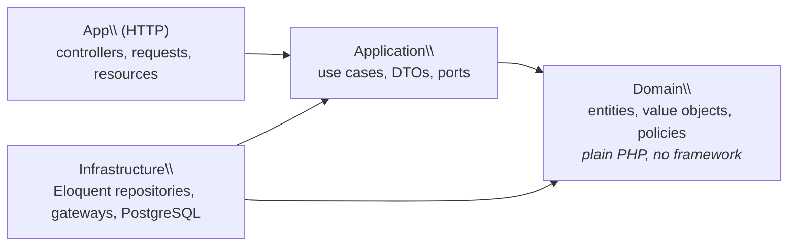

# Bookly

> A space booking API (coworking desks, meeting rooms, sports courts) built to
> show how to design a Laravel application around a framework-free domain: real
> business rules, design patterns where they make sense, and tests at every layer.


## Why this project

Booking is a small domain with non-trivial rules:

- **No overbooking**, even under concurrent requests
- **Dynamic pricing**: peak hours, recurring-booking discounts, coupons
- **Configurable cancellation policies**: 100% refund up to 48h before, 50% up to 24h, and so on
- **Multiple payment gateways** and **notifications** (e-mail, webhooks)

## Architecture



Dependencies point inwards only. This is **enforced by architecture tests**
(`tests/Arch/LayersTest.php`): the build fails if the domain imports Laravel,
Carbon or an outer layer. See [ADR 0001](docs/adr/0001-layered-architecture-with-framework-free-domain.md).

### Highlights

| Concern | Approach |
|---|---|
| Overbooking | PostgreSQL `EXCLUDE USING gist` on a half-open `tstzrange`, partial on `status <> 'cancelled'` ([ADR 0002](docs/adr/0002-exclusion-constraint-for-overbooking.md)) |
| Money | `Money` value object in minor units with a `Currency` enum, so no floats |
| Time | `TimeSlot` value object, half-open `[start, end)`, normalised to UTC, DST-safe durations |
| Code style & safety | `declare(strict_types=1)` everywhere, `readonly` value objects, PHPStan **level max**, Pint, Rector |

## Testing strategy

| Suite | What it covers | Boots Laravel? | Database |
|---|---|---|---|
| `Unit` | Domain rules and value objects | No | None |
| `Arch` | Layer dependency rules, immutability, strict types | No | None |
| `Integration` | Repositories and DB constraints | Yes | **Real PostgreSQL** (not SQLite) |
| `Feature` | HTTP endpoints end to end | Yes | Real PostgreSQL |

```bash
composer test:unit         # fast feedback, no framework
composer test:integration  # against PostgreSQL
composer ci                # pint + rector + phpstan + all tests
```

## Running locally

```bash
cp .env.example .env
docker compose up -d       # app on http://localhost:8000, PostgreSQL on :5432
docker compose exec app php artisan key:generate
docker compose exec app composer test
```

Without Docker, you need PHP 8.3 with `pdo_pgsql` and PostgreSQL 16 with the `btree_gist` extension available.

## Architecture Decision Records

- [0001: Layered architecture with a framework-free domain](docs/adr/0001-layered-architecture-with-framework-free-domain.md)
- [0002: PostgreSQL exclusion constraint to prevent overbooking](docs/adr/0002-exclusion-constraint-for-overbooking.md)

## Roadmap

- [x] Project foundation: layers, tooling, CI, Docker
- [x] `Money` and `TimeSlot` value objects
- [x] Overbooking prevented by an exclusion constraint, with integration tests
- [ ] `Space` and `Booking` aggregates, `BookingRepository` port and Eloquent adapter
- [ ] Pricing rules (Strategy) composed into a pricing pipeline
- [ ] Cancellation policies and refunds
- [ ] Booking validation via composable Specifications
- [ ] Payment gateway port with Fake and Stripe adapters, plus contract tests
- [ ] Domain events → e-mail, webhooks, audit (transactional outbox)
- [ ] REST API with OpenAPI docs and feature tests
- [ ] React + TypeScript dashboard, Playwright E2E
- [ ] NestJS real-time notification service (WebSocket)
- [ ] Mutation testing with Infection
